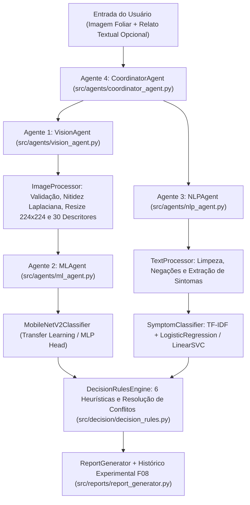

# Arquitetura do Sistema Multiagente — PlantAI

**Instituição:** AFYA | UNIMA Maceió  
**Disciplina:** Inteligência Artificial Aplicada — Prof. Ícaro Ferreira  
**Equipe:** Lucas Gomes, Viny Carnaúba, Fabiano e Nogueira  

---

## 1. Visão Geral da Arquitetura

O **PlantAI** adota uma arquitetura multiagente modular em que quatro agentes especializados cooperam sob um contrato de dados estrito (`src/contracts.py`):

---

## 2. Responsabilidades dos Agentes

1. **Agente 1 — Visão Computacional ([vision_agent.py](file:///c:/Users/vinyc/Downloads/faculdade/6P/IA/Projeto%20IA/src/agents/vision_agent.py)):**
   - Verifica integridade do arquivo, dimensões mínimas (`>= 32x32`), brilho médio (`25.0 <= luminância <= 245.0`) e foco via variância do operador Laplaciano 2D (`>= 18.0`).
   - Redimensiona para `224x224` pixels, normaliza em `[0.0, 1.0]` e extrai 30 descritores visuais (estatísticas RGB, índice ExG, área necrótica, halo clorótico, pústulas ferruginosas, área encharcada e energia de textura).
2. **Agente 2 — Machine Learning ([ml_agent.py](file:///c:/Users/vinyc/Downloads/faculdade/6P/IA/Projeto%20IA/src/agents/ml_agent.py)):**
   - Recebe o objeto `ProcessedImage` do `VisionAgent` e executa a inferência supervisionada com `MobileNetV2Classifier`, retornando `predicted_class`, `confidence` e `top_k`.
3. **Agente 3 — Processamento de Linguagem Natural ([nlp_agent.py](file:///c:/Users/vinyc/Downloads/faculdade/6P/IA/Projeto%20IA/src/agents/nlp_agent.py)):**
   - Normaliza o relato em português brasileiro, preserva partículas de negação (*"sem manchas"*), extrai sintomas canônicos sem inventar informações e classifica via `TF-IDF (1,2-gramas) + LogisticRegression / LinearSVC`.
4. **Agente 4 — Coordenador ([coordinator_agent.py](file:///c:/Users/vinyc/Downloads/faculdade/6P/IA/Projeto%20IA/src/agents/coordinator_agent.py)):**
   - Orquestra os agentes especialistas, aplica as 6 heurísticas do `DecisionRulesEngine`, executa o estudo de ablação (`vision_only`, `nlp_only`, `integrated`), gera o relatório final (`F07`) e exporta o histórico experimental (`F08`).

