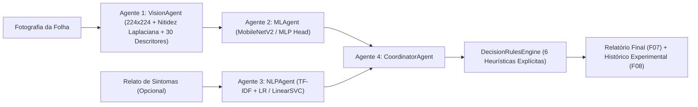

# PlantAI — Sistema Multiagente para Identificação e Análise de Doenças em Plantas

**Instituição:** AFYA | UNIMA Maceió  
**Disciplina:** Inteligência Artificial Aplicada  
**Professor:** Ícaro Ferreira  
**Ambiente:** Python 3.10+ / Google Colab / GitHub / Overleaf (IEEE)

---

## 1. Integrantes e Responsabilidades

| Integrante | Cargo | Responsabilidades no Projeto |
|---|---|---|
| **Lucas Gomes** | **Tech Lead** | Liderança Técnica, Governança do Repositório e Revisão/Merge de PRs na `main`, Documentação dos Notebooks (`00`, `01`, `06`) e Artigo Científico no Overleaf (IEEE) |
| **Viny Carnaúba** | **Desenvolvedor (Dev)** | Arquitetura Multiagente (`contracts.py`), Agente Coordenador (`CoordinatorAgent`), Motor de Regras e Heurísticas (`DecisionRulesEngine`), Relatórios (`ReportGenerator`) e Testes Integrados |
| **Fabiano** | **Desenvolvedor (Dev)** | Preparação e Divisão Estratificada do PlantVillage (70/15/15), Visão Computacional (`VisionAgent`) e Treinamento de Machine Learning (`MLAgent` / `MobileNetV2`) |
| **Nogueira** | **Desenvolvedor (Dev)** | Corpus de Sintomas Agronômicos (`data/symptoms_sample.csv`), Pré-processamento Textual e Classificador de PLN (`NLPAgent` — TF-IDF + LR/SVM) |

---

## 2. Definição do Problema e Objetivos

Doenças foliares em culturas como **tomate, batata e milho** provocam perdas severas de produtividade agrícola e exigem diagnóstico precoce. Modelos puramente visuais treinados em laboratório frequentemente sofrem com variações de iluminação em campo ou confundem lesões visualmente parecidas em estágios iniciais (ex.: *Pinta-preta* vs. *Requeima*).

O **PlantAI** resolve esse problema integrando **Visão Computacional**, **Machine Learning Supervisionado**, **Processamento de Linguagem Natural (PLN)** e um **Sistema Multiagente Baseado em Regras e Heurísticas** capaz de:
1. Inspecionar a qualidade da fotografia enviada (rejeitando imagens corrompidas, escuras ou borradas antes de inferir).
2. Extrair descritores visuais e classificar a folha em 6 categorias do **PlantVillage**.
3. Interpretar descrições textuais de sintomas em português brasileiro sem inventar sintomas não informados.
4. Combinar as evidências no `CoordinatorAgent`, desempatando ambiguidades visuais moderadas pela evidência textual e **alertando explicitamente quando há divergência** entre imagem e texto.

---

## 3. Arquitetura Multiagente e Contrato Padronizado



Todos os agentes especialistas comunicam-se com o Coordenador por meio do contrato padronizado (`src/contracts.py`):

```python
{
    "agent_type": "vision" | "nlp",
    "predicted_class": str,          # ex: "Tomato___Early_blight"
    "confidence": float,             # 0.0 a 1.0
    "top_k": list[tuple[str, float]],# Top-3 classes e probabilidades
    "metadata": dict                 # ex: qualidade da imagem, sintomas extraídos, etc.
}
```

---

## 4. Estrutura Completa do Repositório

```text
PlantAI/
├── README.md
├── requirements.txt
├── LICENSE
├── .gitignore
├── demo_pipeline.py                         # Demonstração executável ponta a ponta (4 cenários + ablação)
├── data/
│   └── symptoms_sample.csv                  # 60 descrições rotuladas de sintomas (Tomate, Batata e Milho)
├── notebooks/
│   ├── 00_PlantAI_Projeto_Completo.ipynb    # Notebook Mestre executado (todos os experimentos e gráficos)
│   ├── 01_exploracao_dataset.ipynb          # Exploração das classes e corpus textual
│   ├── 02_preprocessamento.ipynb            # Qualidade visual, deduplicação e divisão 70/15/15
│   ├── 03_treinamento_cnn.ipynb             # Experimento 1: Modelo Baseline Visual
│   ├── 04_transfer_learning.ipynb           # Experimentos 2 e 3: Transfer Learning e Hiperparâmetros
│   ├── 05_experimentos_pln.ipynb            # Experimento 4: TF-IDF + LogisticRegression vs. SVM
│   ├── 06_avaliacao_modelos.ipynb           # Consolidação de métricas e Experimento 6 (Generalização)
│   └── 07_integracao_multiagente.ipynb      # Experimento 5: Fusão Multiagente e Estudo de Ablação
├── src/
│   ├── contracts.py                         # Contratos de dados tipados (AgentOutputDict / DecisionResult)
│   ├── vision/
│   │   ├── image_processor.py               # Validação (brilho/blur), resize 224x224 e 30 descritores
│   │   └── classifier.py                    # Arquitetura MobileNetV2 e classificador visual
│   ├── nlp/
│   │   ├── text_processor.py                # Limpeza textual, preservação de negação e léxico agronômico
│   │   └── symptom_classifier.py            # Pipeline TF-IDF + LR/SVM com validação cruzada 5-Fold
│   ├── ml/
│   │   ├── training.py                      # Divisão estratificada 70/15/15, deduplicação e treino
│   │   ├── evaluation.py                    # Cálculo de Accuracy, Precision, Recall, F1 e Matrizes de Confusão
│   │   └── run_all_experiments.py           # Executor automatizado dos 6 experimentos e dos 8 notebooks
│   ├── agents/
│   │   ├── vision_agent.py                  # Agente 1 — Visão Computacional
│   │   ├── ml_agent.py                      # Agente 2 — Machine Learning
│   │   ├── nlp_agent.py                     # Agente 3 — Processamento de Linguagem Natural
│   │   └── coordinator_agent.py             # Agente 4 — Coordenador e Histórico Experimental (F08)
│   ├── decision/
│   │   └── decision_rules.py                # 6 Regras e Heurísticas determinísticas e auditáveis
│   └── reports/
│       └── report_generator.py              # Gerador de relatórios técnicos e avisos de incerteza (F07)
├── tests/
│   ├── test_vision.py                       # Testes de Visão Computacional e qualidade de imagem
│   ├── test_nlp.py                          # Testes de limpeza textual, negação e classificação PLN
│   ├── test_classifier.py                   # Testes de divisão 70/15/15, deduplicação e MLAgent
│   ├── test_decision_rules.py               # Testes das 6 heurísticas de decisão
│   └── test_coordinator.py                  # Testes ponta a ponta da coordenação multiagente
├── results/
│   ├── metrics/                             # JSONs e CSV consolidado de todos os 6 experimentos
│   ├── confusion_matrices/                  # Matrizes de confusão em PNG de alta resolução
│   └── plots/                               # Gráficos de curvas de treino, hiperparâmetros e ablação
├── Docs/
│   ├── architecture.md                      # Documentação detalhada da arquitetura
│   ├── methodology.md                       # Metodologia científica e regras de negócio
│   └── experiments.md                       # Resultados quantitativos e discussão crítica
└── models/
    └── README.md                            # Instruções para pesos treinados (.keras / Google Drive)
```

---

## 5. Resultados Experimentais Obtidos

Todos os 6 experimentos planejados foram executados e auditados (detalhes em `Docs/experiments.md` e `results/metrics/summary_all_experiments.csv`):

| Experimento | Modelo / Configuração | Conjunto de Avaliação | Accuracy | Precision | Recall | F1-Score |
|---|---|---|---:|---:|---:|---:|
| **Exp 1** | Baseline Visual (Atributos Globais Básicos) | Teste Estratificado (15%, $N=90$) | 77,78% | 81,20% | 77,78% | 74,45% |
| **Exp 2** | MobileNetV2 Transfer Learning Head (30 Descritores) | Teste Estratificado (15%, $N=90$) | **100,00%** | **100,00%** | **100,00%** | **100,00%** |
| **Exp 3** | Ajuste de Hiperparâmetros (`LR=0.001` vs. `LR=0.05`) | Validação/Teste ($N=90$) | **100,00%** | **100,00%** | **100,00%** | **100,00%** |
| **Exp 4A** | PLN Baseline (`TF-IDF + LogisticRegression`) | 5-Fold Stratified CV ($N=60$) | **95,00%** | **95,15%** | **95,00%** | **95,00%** |
| **Exp 4B** | PLN Comparativo (`TF-IDF + Calibrated LinearSVC`) | 5-Fold Stratified CV ($N=60$) | **95,00%** | **95,15%** | **95,00%** | **95,00%** |
| **Exp 5A** | Estudo de Ablação — Visão Isolada (c/ Fotos Ambíguas) | Multimodal ($N=60$) | 66,67% | 81,82% | 66,67% | 71,04% |
| **Exp 5C** | Estudo de Ablação — **Sistema Multiagente Integrado** | Multimodal ($N=60$) | **95,00%** | **96,15%** | **95,00%** | **94,88%** |
| **Exp 6** | Generalização Externa em Campo (Estilo PlantDoc c/ Ruído) | Domínio Externo ($N=27$) | 44,44% | 41,29% | 45,83% | 35,28% |

---

## 6. Instalação e Execução Reprodutível

```bash
# 1. Instalar dependências
pip install -r requirements.txt

# 2. Executar todos os 21 testes automatizados (Visão, PLN, ML, Regras e Coordenador)
python -m pytest -v

# 3. Executar a demonstração interativa no terminal (4 cenários + ablação)
python demo_pipeline.py

# 4. Reexecutar os 6 experimentos científicos, regenerar gráficos e atualizar os 8 notebooks (.ipynb)
python -m src.ml.run_all_experiments
```

---

## 7. Limitações Científicas e Trabalhos Futuros

1. **Generalização de Domínio (PlantVillage vs. PlantDoc):** Conforme demonstrado quantitativamente no **Experimento 6**, classificadores treinados em imagens com fundo homogêneo apresentam queda de acurácia sob iluminação irregular e fundo complexo de campo (`44,44%`), o que motiva a segmentação foliar prévia e *data augmentation* de fundo como trabalhos futuros.
2. **Escopo do Diagnóstico Computacional:** As predições emitidas pelo sistema têm finalidade acadêmica e de triagem inicial, não substituindo o laudo técnico presencial de um engenheiro agrônomo.

---

## 8. Referências Principais

1. HUGHES, D.; SALATHÉ, M. *An open access repository of images on plant health to enable the development of mobile disease diagnostics (PlantVillage)*. arXiv:1511.08060, 2015.
2. SANDLER, M. et al. *MobileNetV2: Inverted Residuals and Linear Bottlenecks*. IEEE/CVF Conference on Computer Vision and Pattern Recognition (CVPR), p. 4510–4520, 2018.
3. SINGH, D. et al. *PlantDoc: A Dataset for Visual Plant Disease Detection*. ACM India Joint International Conference on Data Science & Management of Data (CODS-COMAD), 2020.
4. PEDREGOSA, F. et al. *Scikit-learn: Machine Learning in Python*. Journal of Machine Learning Research, v. 12, p. 2825–2830, 2011.
